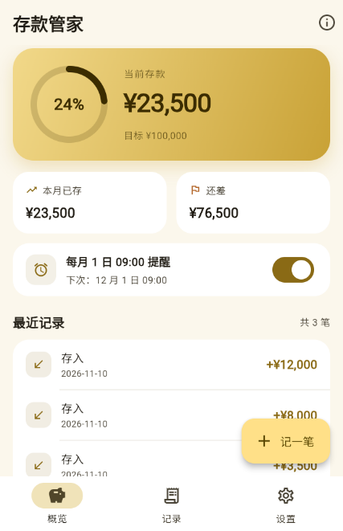
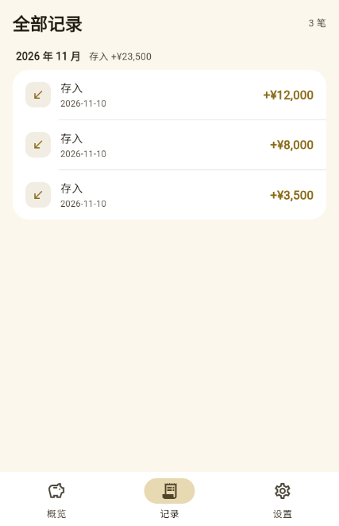
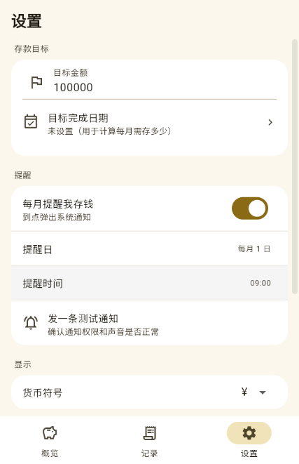
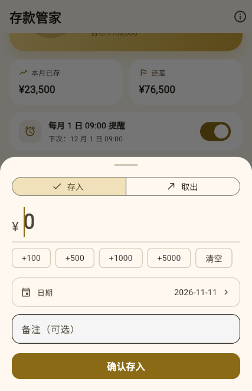

# 存款管家（savings_tracker）

一个只给自己用的 iOS 存款记录 App：记存款余额、看目标进度、每月固定日弹通知提醒存钱。
**数据只存在手机本地（SharedPreferences），不上传任何服务器。**



| 记录 | 设置 | 记一笔 |
|---|---|---|
|  |  |  |

---

## 已经验证过的

- `flutter analyze` 零告警
- `flutter build web` 通过，并在浏览器里实际跑通了「记一笔 → 余额/进度/记录同步更新」的完整流程（上面截图就是跑出来的）
- iOS 通知逻辑已写好，但**只能在真机上验证**，装好后请先到 设置 → 发一条测试通知 确认

---

## 功能

- **概览**：当前存款总额、目标完成百分比环、本月已存 / 还差多少、下次提醒时间
- **记一笔**：存入 / 取出，快捷金额（+100 / +500 / +1000 / +5000）、选日期、写备注
- **记录**：按月分组，显示当月存入合计，左滑删除
- **设置**：目标金额、目标完成日期（自动算「每月需存多少」）、货币符号（¥ $ € Kz £）、每月提醒日与时间、JSON 备份复制、清空数据
- **每月提醒**：本机定时通知（flutter_local_notifications），不依赖服务器和推送证书

---

## 一、本地预览（这台 Windows 上）

这台机器已经装好 Flutter 3.47.9（`C:\Users\Admin1\dev\flutter`）和 PortableGit（`C:\Users\Admin1\dev\git`），并已加入用户 PATH（**新开一个终端才生效**）。

```powershell
cd C:\Users\Admin1\Doubao\chats\2026-11-10\new-chat-7\savings_tracker
flutter pub get
flutter run -d edge          # 用 Edge 预览（这台机器没装 Chrome）
```

改代码保存后浏览器会自动热重载。Windows 只能预览界面和交互，**.ipa 必须在 macOS 环境构建**，见下一节。

---

## 二、不用 Mac：Codemagic 云构建出 IPA

### 1. 代码放上 GitHub

1. 装 GitHub Desktop：https://desktop.github.com
2. File → Add local repository → 选 `savings_tracker` 文件夹
3. 提示 not a git repository 时点 **create repository**，再 Publish repository（建议勾 Private）

### 2. Codemagic 构建

1. https://codemagic.io 用 GitHub 账号登录
2. Add application → 选刚推上去的仓库
3. 项目类型选 **Flutter**，仓库里的 `codemagic.yaml` 会被自动识别
4. 选 workflow `ios-personal` → Start new build
5. 约 10 分钟，产物里下载 **`SavingsTracker.ipa`**
6. 免费额度每月 500 分钟，一次构建 5~8 分钟，个人用足够

> 走的是 `flutter build ios --no-codesign`，产出**未签名 IPA**，
> 不需要 Apple 开发者账号、不需要配证书。签名交给下一步。

---

## 三、装到自己 iPhone（Windows 就能做）

### 方式 A：Sideloadly（最直接）

1. https://sideloadly.io 装到这台 Windows
2. iPhone 数据线连电脑，手机上点「信任此电脑」
3. Sideloadly 里选 `SavingsTracker.ipa`，Apple ID 填自己的
4. Start → 输入 Apple ID 密码（走苹果官方签名）
5. 手机：设置 → 通用 → VPN与设备管理 → 开发者 App → 信任你的 Apple ID
6. iOS 16+ 还要：设置 → 隐私与安全性 → **开发者模式** 打开 → 重启手机

### 方式 B：AltStore（能自动续签，长期推荐）

1. 这台 Windows 装 **AltServer**（https://altstore.io），托盘右键 → Install AltStore → 选你的 iPhone
2. 手机上用 AltStore 安装 `SavingsTracker.ipa`
3. 之后同一 WiFi 下，电脑会自动帮你续签，基本不用管

### 有效期

| 账号 | 有效期 | 代价 |
|---|---|---|
| 免费 Apple ID | **7 天**，过期 App 打不开，要重新签 | 0 元，AltStore 可自动续 |
| Apple Developer（$99/年） | 1 年 | 顺便能用 TestFlight，免每周续签 |

**签名过期后 App 会闪退、通知也会停**，这点要有心理准备。

---

## 四、改哪里

| 想改什么 | 文件 |
|---|---|
| 配色（金色主题） | `lib/theme.dart` → 改 `GoldPalette` 里的几个色值即可全局生效 |
| 概览页布局 | `lib/screens/home_page.dart` |
| 记一笔弹窗 | `lib/screens/add_deposit_sheet.dart` |
| 记录页 | `lib/screens/history_page.dart` |
| 设置项 | `lib/screens/settings_page.dart` |
| 提醒逻辑 / 文案 | `lib/services/reminder_service.dart` |
| 金额、日期格式化 | `lib/utils/format.dart` |
| 数据结构 | `lib/models/` |
| 本地存取 | `lib/services/storage.dart` |
| 主屏幕小组件数据推送 | `lib/services/widget_bridge.dart` |
| 小组件界面 | `ios/SavingsWidget/SavingsWidget.swift` |

改完推送 GitHub → Codemagic 重新构建 → Sideloadly 重装，就是一轮循环。

---

## 五、主屏幕小组件（已写好代码，但有硬前提）

代码全在仓库里，App 侧的数据推送也接好了：每次改动数据都会把快照写进 App Group 并刷新小组件。

**但要用起来，必须先满足两个条件：**

1. **付费开发者账号（$99/年）** —— 小组件读 App 数据只能走 App Group，免费 Apple ID 的描述文件里没有这个授权，装上也会一直显示「打开存款管家」。换签名器、勾自定义 entitlements 都没用，问题不在签名器而在描述文件。
2. **用一次 Xcode 创建 Widget 扩展 target** —— 扩展是项目里独立的 target、独立 Bundle ID，只能在 Xcode 里建。租一小时云 Mac（MacinCloud/MacStadium，$1~2/小时）就能做完，15 分钟。

完整操作步骤（Apple 后台配 App Group → Xcode 建扩展 → Codemagic 自动签名 → TestFlight 装机）写在 **[docs/小组件配置步骤.md](docs/小组件配置步骤.md)**。

> 这段 Swift 我这边没有 macOS，无法编译验证。如果 Xcode/Codemagic 报错，把日志贴回来我改。

---

## 六、已知限制

- 提醒是**每月固定日**（1~28 号可选），不是「每隔 N 天」。
- 时区按设备当前 UTC 偏移（固定偏移，不含夏令时）。安哥拉 UTC+1、中国 UTC+8 都没夏令时，不受影响；去有夏令时的国家提醒可能差 1 小时。
- 删除记录或清空数据不可恢复，重要数据先用设置页「复制数据」粘到备忘录备份。
- 没有 iCloud 同步、没有多设备、没有密码锁。
- 主屏幕小组件依赖 App Group，免费签名不可用；小组件刷新受 iOS 系统节流，后台最多 30 分钟一次。
- App 图标是金色小猪储钱罐，全部尺寸已覆盖（iOS 15 个尺寸 + Android 5 个 + Web 图标）。源图在 `docs/app-icon-源图.png`，要改图标就用它重新切图。
